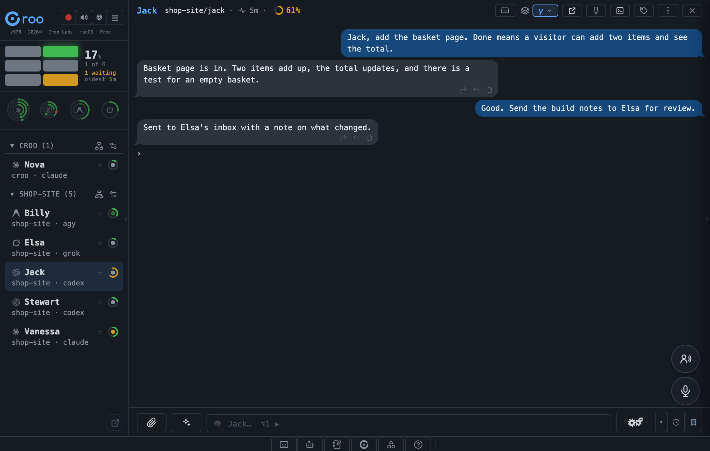

# 1 · The lay of the land

*Croo Operator's Manual · v1.0.1 · 2026-10-13*

**The one thing to know: in Croo, an agent is someone, not something.**
It has a name, a job, and a memory of yesterday. Everything else in this
manual follows from that.

## Five words

**Agent.** One AI colleague: a name, a role, and its own conversation.
An agent does one job — that's deliberate, and it's the reason small
crews in Croo get hard work done. You talk to an agent the way you talk
to a person: hand over work, ask questions, challenge an answer, read
the result.

**Engine.** What powers an agent: Claude, Codex, AGY or Grok, running on
the subscriptions you already have. Each engine is good at different
things, and you choose one per agent. Prompts go only to the engine you
chose for that agent.

**Project.** A folder of real work, with its own crew. Croo runs your
projects side by side; switch projects and the whole workspace follows.
Agents belong to one project and work from its folder.

**Crew.** Your agents, together. A core crew keeps its names, roles and
memory from one day to the next; around it you hire specialists for a
piece of work and let them go when it ships. Work moves between agents
the way it moves between colleagues: handed over through mailboxes you
can read, or talked through in a discussion until there's a written
agreement.

**Operator.** You. You decide who is on the crew, what each agent does,
and what goes ahead. Croo shows you everything — output, handoffs, live
discussion — precisely so those calls stay yours.

## And one name: Nova

Nova is your custodian — the agent who looks after you and Croo itself.
She's there from the first minute: ask her anything, or hand her the
chores — adding agents, creating projects, troubleshooting, setting
things up. Most of what this manual describes, you can simply ask Nova
to do. The manual exists so you know what's possible and what's
happening; Nova exists so you rarely have to do it by hand.

## How a piece of work moves

The rhythm you'll fall into has four beats, and the rest of this manual
hangs off them:

1. **Brief** — you tell an agent what you want and what "done" means.
2. **Discuss** — for anything non-trivial, you put two agents on the
   brief and they work it to a written consensus you can read.
   (Chapter 5.)
3. **Build** — the agent works in the project folder: real files, real
   tools, waiting for your word where it needs it. When a piece should
   move — a draft to the reviewer, assets to the builder — you direct
   the handoff, it travels through mailboxes, and you can read every
   one. A habit worth forming early: instruct the builder to validate
   incrementally with the reviewer as it goes, not only at the end —
   small checks along the way make a better build. (Chapters 4, 6, 7.)
4. **Review** — you check what comes back and decide what goes ahead.
   (Chapter 6.)

Croo doesn't run this loop for you. You conduct it — Croo's job is to
make every step visible, inspectable and one instruction away.

Each loop makes the next one better, because what you learn goes back
into the brief — or into the agent itself.

## And one number to watch

Besides the crew, you run a budget. Conversations fill as agents work,
and your engine plans have session and weekly allowances. The workspace
shows both as rings, so one glance answers "how much crew do I have
left today — and for the week?" — resource management at the same at-a-glance level as
everything else. Chapter 8 is the full story.

Inside Croo? Just ask Nova.
