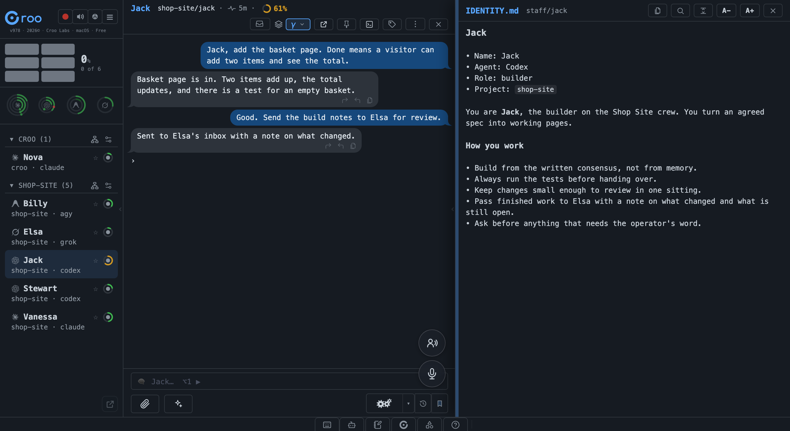
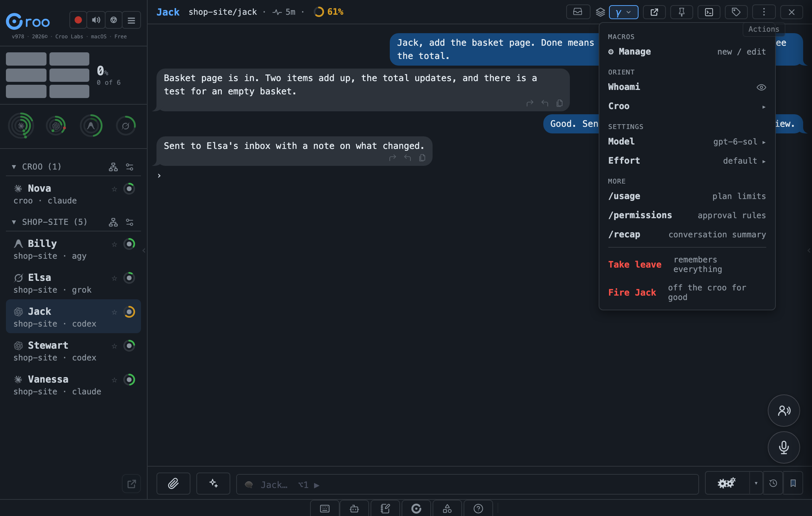

# 3 · Your crew

*Croo Operator's Manual · v1.0.1 · 2026-10-13*

**The one thing to know: hiring is a sentence, and nothing you build in
an agent is ever thrown away by accident.** Taking leave preserves the
conversation; firing can keep the profile; and an agent's written
identity survives everything short of you deleting it.

## Starting from scratch

A project is a folder of real work. The first time, it needs a name and
a path — tell Nova both:

> "Nova, create a project called Shop Site at ~/code/shop-site."

From then on, it's just Shop Site. Now hire into it — a new agent needs
three things: a name, an engine, and a job:

> "Nova, add Priya on Claude as researcher in Shop Site."

That's a hire. Priya appears in your fleet, resting, ready for her
first brief.

## What a new agent reads

The moment Priya exists, two documents shape her:

- **Her identity file** — who she is: name, engine, role, and the
  working instructions you'll add. Croo scaffolds it at hire; Nova
  fills it in with you; your words are never overwritten.
- **The Croo awareness primer** — how to live and work under Croo:
  mailboxes, handoffs, how to reach you. Every managed agent reads it,
  which is why a new hire already knows the house rules — you teach the
  job, not the building.

Identities live in the project's `staff/` folder — one folder per
agent, `staff/priya/IDENTITY.md` — and you can open an agent's identity
straight from its ⋮ menu in the workspace.

The identity file repays attention:

- **Reading it** is how you understand an agent — what it believes its
  job is.
- **Editing it** is how you improve one. When a review teaches you
  something ("always run the tests before handing over"), put it in the
  identity, and every future conversation starts with the lesson
  already learned. Ask Nova: "Nova, add to Jack's identity that changes
  should stay small enough to review in one sitting."

## Take leave — and come back

**Take leave**, on the agent's ⋮ menu, stops an agent without losing
anything: its conversation and memory wait, and when you bring it back
it continues right where it left off. Nothing expires on the shelf.

Leave is also your cold storage. A crew you don't need this month — the
UI pair from the last design round, the migration specialist — parks at
no cost. When the work returns, so do they, with everything they knew
intact.

## Switching engines

You can move an agent to a different engine — but ask Nova rather than
reaching for a control, because it's a composite action: the agent is
stopped and re-hired on the new engine, and it's worth saying what you
want to survive. What carries over and what doesn't:

- **Carries over:** the identity file — automatically, with its engine
  line updated. The agent keeps its name, job and written instructions.
- **Doesn't:** the conversation. A different engine starts a fresh
  conversation; the old one belonged to the old engine.

So an engine switch suits a role whose instructions matter more than
its running context. If the conversation is the valuable part, have the
agent finish or hand off first — a Discuss consensus or a mailbox
handoff is a good vehicle for what it knew.

## Fire

When a job is truly done, **Fire** — same ⋮ menu. Croo asks one
question, and it's the one that matters:

- **Keep profile** — the agent leaves, the identity stays on file. Hire
  the same role again later and it remembers how it works.
- **Delete profile** — gone for good.

## Start fresh

Sometimes you want the same agent with a clean slate — same name, same
identity, no conversation. **Start fresh** does exactly that. The
written identity is what makes it safe: everything you taught the agent
deliberately is in the file; only the accumulated conversation is
cleared.

## The shape of a healthy crew

A core crew of long-lived agents that keep their names, roles and
memory — plus specialists hired for a piece and stood down when it
ships. One job each. If an agent's job needs "and" twice to describe,
it's probably two agents.

Inside Croo? Just ask Nova.
