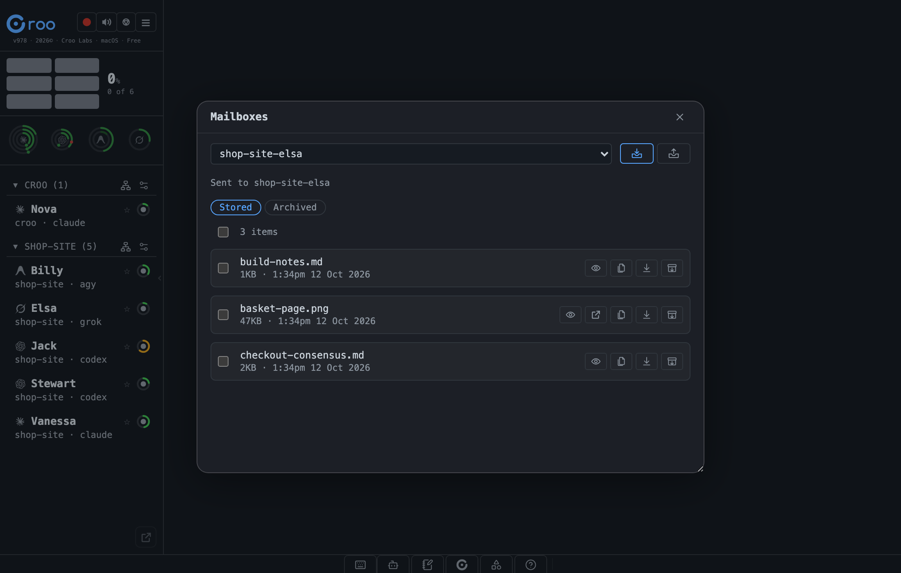

# 6 · Mailboxes and handoffs

*Croo Operator's Manual · v1.0.1 · 2026-10-13*

**The one thing to know: in Croo, work is passed, not shared — and
every pass leaves a record you can open.** No shared scratchpad where
three agents overwrite each other; a handoff is a deliberate act, with
a sender, a receiver and a paper trail.

## How it works

Every agent has a mailbox: an inbox and an outbox. When an agent
finishes something for you, it lands there. When one agent passes work
to another — a draft to the reviewer, assets to the builder — it
travels the same way: files and messages, agent to agent, through
mailboxes you can read.

You direct the traffic. "Jack, send the build notes to Elsa" is a
handoff; so is forwarding one agent's chat reply to another (chapter
4); so is the standing instruction in Jack's identity to pass finished
work with a note on what changed. Agents don't swap work behind your
back — the mailbox is where moving work becomes visible.

## Reading the traffic

Open any mailbox and work with what's there: open and preview items,
copy or download them, archive what's settled, restore what you
archived too soon. Nothing an agent delivers is locked away in a
conversation — it's an item you can take and use.

This is also your morning habit from chapter 2: the mailbox answers
"what moved while I was away?" — what landed for you, and what the
crew passed to each other overnight.

## Why passed, not shared

The pattern buys you three things, and they compound:

- **Inspectability.** Every handoff is an item with a history. When a
  build goes wrong, you can read exactly what the builder gave the
  reviewer, and when.
- **Clean context.** Each agent holds only what its job needs
  (chapter 1). Handoffs move the *result* of one job into the next —
  not the whole mess that produced it.
- **Accountability in plain sight.** A sender, a receiver, a time, a
  thing. The same reasons offices run on handed-over work rather than
  one shared desk.

## Habits that pay

- **Handoffs carry a note.** "Here's the build" is worse than "Here's
  the build — auth done, tests green, the session-expiry case is still
  open." Put the note habit in your agents' identities once.
- **Finished work goes through the mailbox, even when the chat would
  do.** The chat scrolls; the mailbox keeps. Deliverables deserve the
  one that keeps.
- **Archive as you accept.** A mailbox where everything is "current"
  tells you nothing. Accept, archive, and what's left is what's open.

Inside Croo? Just ask Nova.
