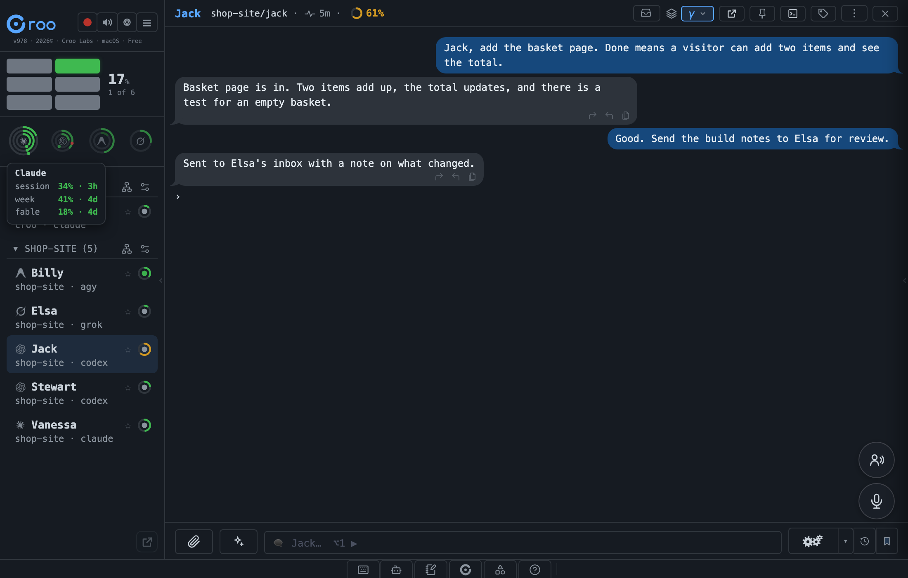

# 8 · Usage and engines

*Croo Operator's Manual · v1.0.1 · 2026-10-13*

**The one thing to know: you're managing two kinds of fuel — each
agent's conversation, and each engine's allowance — and both are one
glance away.** Nothing here needs arithmetic; the rings do it.

## The two fuels

**Conversations fill.** An agent's conversation has a token limit —
the more it holds, the fuller it gets. Croo shows each agent's usage
as a ring that fills as the agent works.

**Allowances run down.** Your engine plans come with allowances —
typically a session allowance that renews within the day, and a weekly
one. Croo shows a gauge for every engine you run, session and week, so
you always know how much engine you have left. These renew on your
plan's clock; the rings just tell you where you stand.

One habit covers both: the glance you already do each time you sit
down (chapter 2).

## Compacting

Every engine tidies its own conversation automatically when it has to —
compaction happens whether or not you ever touch it. AGY handles it
entirely on its own; there's nothing for you to press. For the others
(Claude, Codex, Grok), Croo also gives you the manual option: when an
agent is idle and its ring runs past 90%, one click compacts it — the
agent tidies its conversation, keeping what matters and making room to
continue, and the compacting state (chapter 2) shows while it works.

Why press it yourself when it would happen anyway? Timing. Compacting
on your schedule — before the next big run — beats the engine deciding
to compact in the middle of one.

Compacting is normal housekeeping, not an emergency. Long-lived agents
compact many times in their lives; the identity file (chapter 3) is
why the things you taught them deliberately never depend on it.

## Model and effort, per agent

Each agent runs the model and effort level you choose for it, from its
own menu. The practical pattern:

- **Heavy model, high effort** for the work that earns it — planning,
  review, the hard build.
- **Lighter settings** for the routine — summaries, housekeeping,
  first drafts.

Matching the setting to the job is the single biggest lever you have
on how far an allowance goes.

## Pacing a day

- **Spend the allowance — it's paid for.** The weekly gauge isn't a
  score to keep low; ending the week with engine unused is the only
  way to lose.
- **Put the heavy jobs early in a session**, when the allowance is
  fresh, and let the routine ride on what's left.
- **Watch the week, not just the day.** A Thursday glance at the
  weekly rings tells you whether Friday can afford the big refactor —
  before you brief it.
- **Who pays for what, plainly:** the engines run on your own
  subscriptions (chapter 1). Croo spends nothing on its own — it shows
  you what your plans are doing.

Inside Croo? Just ask Nova.
