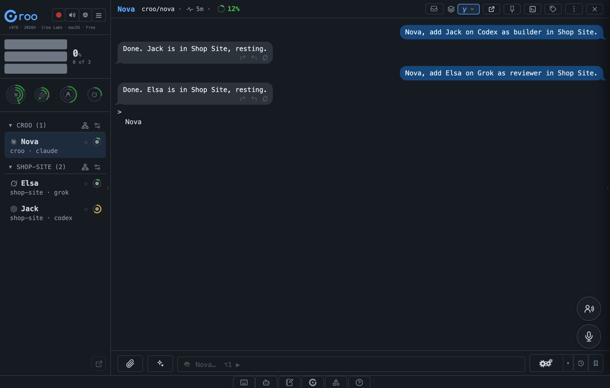
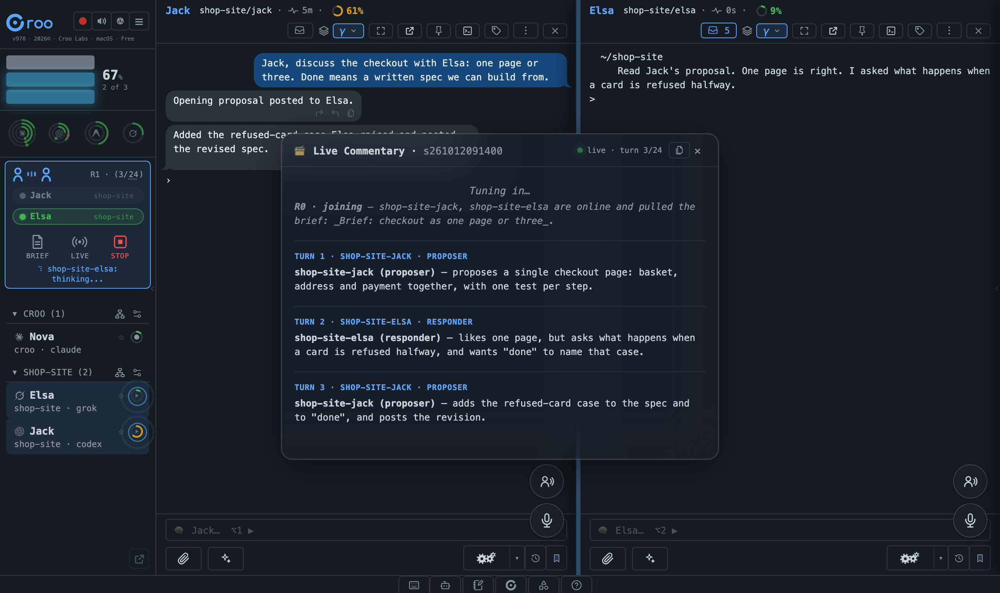
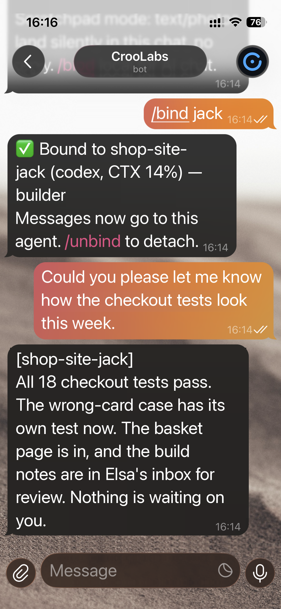

# Playbook: Software (DRAFT 3, 2026-10-10 — fact-checked against the v971 ordinary profile; control names match the locked What/How site copy)

*You write code, or you're about to. Here's how a one-person software
operation runs on Croo — from an empty project to a shipping rhythm.*

Inside Croo? Just ask Nova. Everything below is something she can set up
with you.

## The crew to hire

Start with two agents, not five. You can always hire later, and a small
crew is easier to learn with.

- **A builder.** The one who writes the code. Give it the engine you
  already trust for coding and a clear job: "lead developer on <project>".
- **A reviewer.** A second pair of eyes on a different engine. Its job is
  to check plans before they're built and work before it counts —
  different engine, so you get a genuinely second opinion, not an echo.

Tell Nova, in your own words:

> "Nova, create a project called Shop Site at ~/code/shop-site and add two
> agents: Jack on Codex as lead developer, and Elsa on Claude as reviewer."

Croo scaffolds each agent's identity file; Nova fills it in with you. Here
is a working pair to start from — hand them to Nova as they are, or make
them yours:

**Jack — lead developer**
> Role: lead developer on Shop Site.
> You own the build. For any new piece of work, write a short brief first:
> what it is, what "done" means, what you'll test. Take the brief to a
> discussion with Elsa before you build anything non-trivial, and build
> from the written consensus, not from memory. Keep changes small enough
> to review in one sitting, run the tests before you hand anything over,
> and pass finished work through the mailbox with a note on what changed.

**Elsa — reviewer**
> Role: reviewer on Shop Site.
> You are the second opinion, not a second builder. Validate Jack's briefs
> and plans in discussion: look for what's missing, what's riskier than it
> sounds, and what "done" fails to pin down. During the build, when work
> arrives in your mailbox, check it against the consensus — does it do
> what was agreed, do the tests cover the risky part, would you ship it?
> Report what you find plainly. You never fix things yourself; you send
> them back with reasons.

As the work grows, hire for the piece: a researcher to compare options
before you commit, or a specialist for a bounded job. Specialists retire
when their piece ships; Jack and Elsa stay, and keep their memory.

## The first project

Don't start with "build the app". Start with one piece you can review in
an afternoon — a real feature, small enough to judge.

1. **Brief the work.** Tell Jack what you want and what "done" means, the
   way you'd brief a contractor. Attach anything that helps: a sketch, a
   sample, the error you're seeing.
2. **Discuss before code.** For a new plan, two heads are simply better:
   put Jack and Elsa in a **Discuss** — either they land somewhere better
   than either would alone, or Elsa validates Jack's plan and you proceed
   with confidence. You read the live commentary either way, and the
   disagreements you see are where the traps live. If the exchange is
   earning it, raise the turn limit and let it run.
3. **Build from the plan.** Jack works in the project folder: real files,
   real tools, real test runs. Watch him work, or go do something else —
   he'll wait for your word at anything that needs it.
4. **Review before it counts.** Elsa checks the build against the
   consensus; then you read the result and decide what goes ahead. Every
   lesson goes back into the brief or an identity file, so the next loop
   starts smarter.

## Adding a third: the UI agent

When the interface becomes real work, hire for it — and onboard the new
agent the way you'd onboard a person.

> "Nova, add Uma on AGY as UI designer in Shop Site."

Have Uma develop the assets and screens. Tell Jack it's happening — he
owns the build, and surprises between colleagues are as expensive here as
anywhere. Then let the two of them talk: a short discussion on how they'll
work together — where Uma's assets land, what Jack needs with each
handoff, who checks rendered screens against the design. They'll propose a
process; you approve it, and it becomes how the crew works. That's the
pattern for every hire after: one job, a clear handoff, and the colleagues
agree the seam between them.

Three agents is a real operation. Past that, you'll know what you need.

## A typical week

- **Morning.** Open the workspace, read the room: who's waiting on you,
  what landed in the mailbox overnight. Answer the waits first — a
  waiting agent is a stopped agent.
- **Briefing.** Queue the day's work. While an agent is busy, write the
  next instruction and pin it as a draft — hand it over when the agent
  frees up.
- **During the day.** Let Power-Through carry the routine approvals for a
  stretch while you watch; the red button cuts every standing approval
  the moment you want your hands back on the wheel.
- **Away from the desk.** Bind Telegram to your builder. Status checks,
  quick answers, and the "tests pass" message all reach your phone — and
  your word reaches the crew.

- **Friday.** Retire the specialist whose piece shipped — or put the UI
  crew on leave until the next design round; they come back with memory
  intact. Skim the week's consensuses and mailbox handoffs; anything
  worth keeping goes in the project's notes or your Work Map.

## What to watch

- **Usage.** Each agent's ring fills as its conversation grows. When a
  ring is nearly full and the agent is idle, one click compacts it.
  Session and weekly rings tell you how much engine you have left —
  pace the heavy jobs accordingly.
- **The plan, not just the diff.** Elsa checks the build against what was
  agreed; that only works if the agreement was written down. When you
  skip the Discuss, you're the only safety net.
- **One job each.** The moment one agent is holding the frontend, the
  database and the deploy script in its head, split the work. Narrow
  agents are the whole trick.
- **Your own judgment.** Croo shows you everything — handoffs, commentary,
  output — precisely so the judgment calls stay with you. If something
  reads wrong, stop it and ask. Nothing goes ahead without you.
